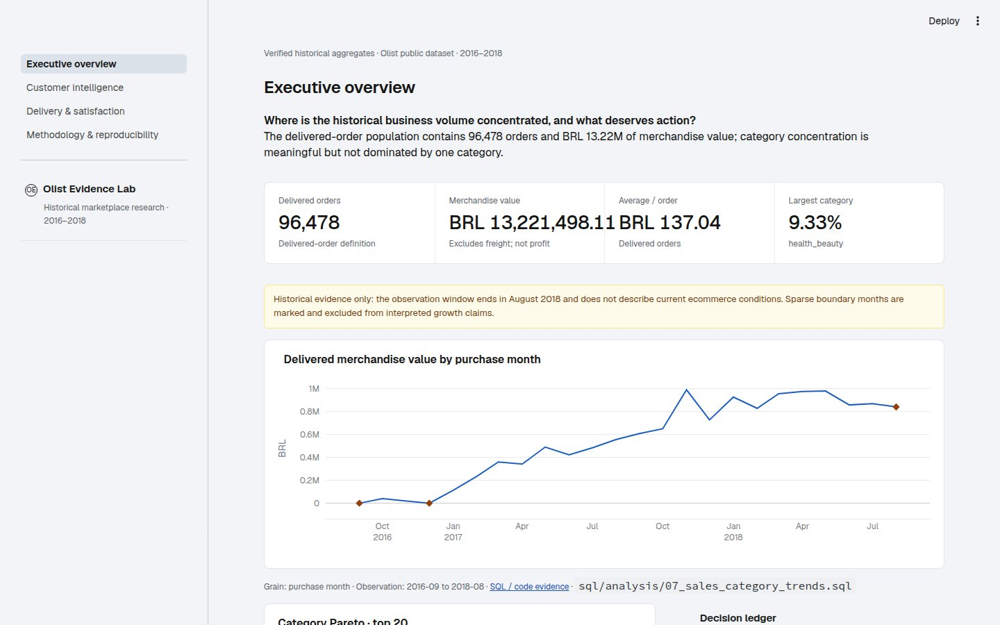
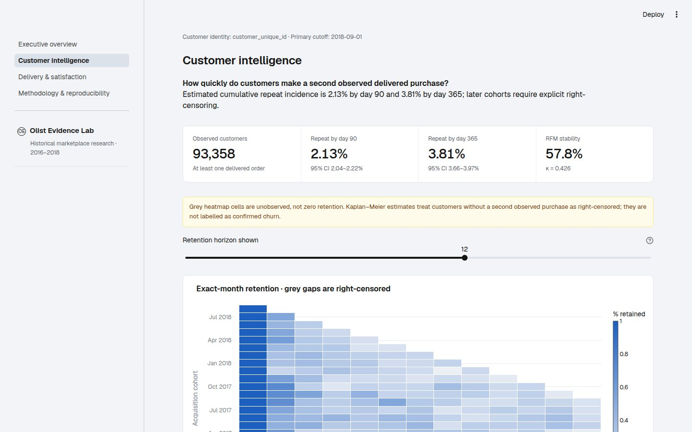
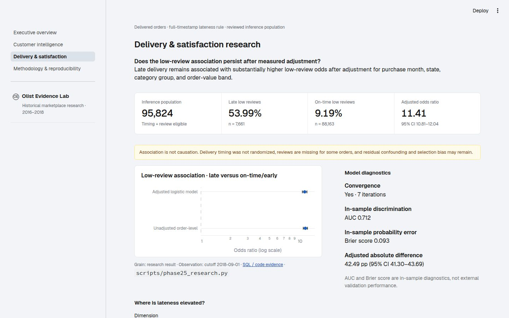

# Olist Ecommerce SQL Business Analytics

A reproducible SQL, statistical research, and interactive analytics portfolio built from the **Olist Brazilian E-Commerce Public Dataset** (anonymized marketplace orders from 2016–2018). Phase 3 presents the verified Phase 1–2.5 evidence through a responsive Streamlit and Plotly dashboard without redefining historical metrics.



> Historical research only. The observation window ends in August 2018; delivery/review results are associations, not causal effects or current-market estimates.

## What is included

- Standard-library Python ingestion with explicit type and timestamp handling
- Nine source-grain SQLite tables with keys, relationships, checks, and indexes
- Transactional, idempotent rebuild: a failed load never replaces the last good database
- Data-quality SQL for counts, missingness, keys, joins, chronology, cardinality, categories, and fan-out risk
- Delivered-order KPI queries for summary/repeat behavior, monthly merchandise value, category concentration, review distribution, and delivery timeliness versus reviews
- Deterministic fixture tests that require no private data or third-party packages
- Monthly acquisition cohorts with explicit right-censoring instead of false zero retention
- Tie-preserving RFM scoring at a fixed cutoff, with customer and merchandise contribution summaries
- Boundary-aware monthly trends, category Pareto analysis, and comparable category-mix changes
- State/category delivery diagnostics plus order-level confidence intervals and stratified association testing
- Standard-library Python pipeline producing auditable CSV/JSON outputs and five portable SVG charts
- Separate four-grain analytics mart with 12 blocking uniqueness, relationship, null, and reconciliation assertions
- Kaplan–Meier time-to-second-purchase estimates with Greenwood intervals and cutoff sensitivity
- Adjusted grouped-binomial logistic models with absolute-risk standardization, diagnostics, subgroup heterogeneity, and missing-review sensitivity
- Independent real-data audit tests and research documentation grounded in established methods
- Four-page Streamlit portfolio dashboard with Plotly tooltips, uncertainty, censoring, lineage, and responsive layouts
- Aggregate-only data contracts, safe downloads, useful missing-data states, and automated dashboard smoke tests

## Repository layout

```text
data/raw/          # Place the nine source CSVs here (ignored by Git)
data/processed/    # Generated SQLite database (ignored by Git)
docs/              # Source, dictionary, metric, and quality documentation
reports/           # Reproducible run reports
scripts/           # User-facing build and analysis commands
sql/schema/        # SQLite DDL
sql/marts/         # Separate analytical-mart build and validation SQL
sql/analysis/      # Quality checks and business queries
src/               # Ingestion implementation and source manifest
tests/             # Small synthetic fixtures and behavior tests
visualizations/    # Reproducible Phase 2 static SVG charts
dashboard/         # Phase 3 contracts, charts, and shared UI
app/               # Streamlit entrypoint and four analytical pages
```

## Quick start

Requirements: Python 3.11 or newer. Phase 1–2.5 pipelines use the standard library; the Phase 3 app adds pandas, Plotly, and Streamlit.

### Launch the portfolio dashboard

The checked-in aggregate outputs are sufficient; raw CSVs and SQLite files are not required to view the dashboard.

```bash
python3 -m venv .venv
.venv/bin/python -m pip install -r requirements.txt
.venv/bin/streamlit run app/streamlit_app.py
```

Open `http://localhost:8501`. The app contains Executive Overview, Customer Intelligence, Delivery & Satisfaction Research, and Methodology & Reproducibility pages.





For Streamlit Community Cloud, choose `app/streamlit_app.py` as the entrypoint. See [Phase 3 data contracts](docs/PHASE3_DATA_CONTRACTS.md) and the [implementation record](reports/PHASE3_IMPLEMENTATION.md) for other deployment options and the precomputed/dynamic boundary.

### Rebuild the research source data

1. Obtain the dataset using [docs/DATA_SOURCE.md](docs/DATA_SOURCE.md) and place all nine CSVs directly in `data/raw/`.
2. Build the database:

   ```bash
   python3 scripts/build_database.py
   ```

3. Run every quality check and analysis:

   ```bash
   python3 scripts/run_analysis.py
   ```

4. Run the tests:

   ```bash
   .venv/bin/python -m unittest discover -s tests -v
   ```

5. Generate Phase 2 evidence files and all charts:

   ```bash
   python3 scripts/phase2_analysis.py
   ```

   This writes SQL-derived CSV extracts and `statistical_results.json` to `reports/phase2_outputs/`, plus five SVG files to `visualizations/`. Re-running the command replaces files with deterministic outputs from the selected database.

6. Build and validate the separate Phase 2.5 analytical mart, then run the research analyses:

   ```bash
   python3 scripts/build_analytics_mart.py
   python3 scripts/phase25_research.py
   ```

   The mart is written to ignored `data/processed/olist_analytics.sqlite`; source tables are not modified. Research evidence is written to `reports/phase25_outputs/` with two additional SVG charts.

Run one analysis only with, for example:

```bash
python3 scripts/run_analysis.py --query 01_monthly_merchandise_value.sql
```

The default `run_analysis.py` command now executes Phase 1 and Phase 2 SQL files. To inspect one new module, use `--query 05_customer_cohort_retention.sql` (or 06–08).

The default generated database is `data/processed/olist.sqlite`. Both raw data and generated databases are intentionally ignored by Git.

## Analytical policy

Commercial KPIs use only `order_status = 'delivered'`: this represents completed fulfillment and avoids treating canceled, unavailable, or still-processing orders as realized merchandise activity. Merchandise value is `SUM(order_items.price)` and explicitly excludes freight. Payments and reviews are pre-aggregated to order grain before any cross-domain join.

This public historical dataset is not the author's Shopify store. It does not contain sessions, ad spend, cost of goods, or randomized treatment assignment, so it cannot establish true site conversion, ROAS, CAC, product profit, or A/B-test lift. Delivery/review results are associations, not causal effects. See [metric definitions](docs/METRIC_DEFINITIONS.md) for full semantics.

## Documentation

- [Data source, attribution, license, and download](docs/DATA_SOURCE.md)
- [Data dictionary](docs/DATA_DICTIONARY.md)
- [Metric definitions](docs/METRIC_DEFINITIONS.md)
- [Data-quality framework](docs/DATA_QUALITY.md)
- [Phase 1 run status](reports/PHASE1_RESULTS.md)
- [Phase 2 advanced analytics results](reports/PHASE2_RESULTS.md)
- [Phase 2.5 independent audit](docs/PHASE25_AUDIT.md)
- [Phase 2.5 statistical methods](docs/PHASE25_STATISTICAL_METHODS.md)
- [Phase 2.5 research results](reports/PHASE25_RESEARCH_RESULTS.md)
- [Phase 2.5 executive brief](reports/PHASE25_EXECUTIVE_BRIEF.md)
- [Phase 3 dashboard data contracts](docs/PHASE3_DATA_CONTRACTS.md)
- [Phase 3 implementation and QA record](reports/PHASE3_IMPLEMENTATION.md)
