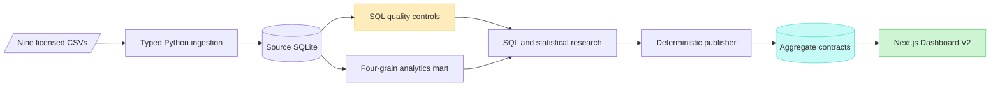

# Olist Evidence Lab

## E-Commerce Analytics & Decision Intelligence

Olist Evidence Lab is an end-to-end analytics research portfolio built from the public Brazilian Olist marketplace dataset. It combines grain-safe SQL, a validated SQLite analytics mart, survival analysis, adjusted delivery-satisfaction research, deterministic aggregate contracts, and a four-page Next.js evidence dashboard. The project is designed to show not only *what* the historical data says, but also which population, denominator, uncertainty, and limitation belong to every decision.

[Dashboard V2](#dashboard-v2) · [Verified evidence](#verified-evidence) · [Research case studies](#research-case-studies) · [Architecture](#technical-architecture) · [Reproduce](#run-and-reproduce) · [Documentation](docs/README.md)

> **Historical and observational evidence.** The analytical window ends in August 2018. Merchandise value is not profit, observed inactivity is not confirmed churn, and delivery/review associations are not causal effects.

## Dashboard V2

Dashboard V2 is a responsive Next.js research product over validated aggregate contracts. It does not query raw Olist files, expose customer-level rows, or refit statistical models in the browser. A public Next.js deployment has not yet been verified; use the [local launch instructions](#launch-dashboard-v2).

| Executive overview | Customer intelligence |
|---|---|
| [](web/app/page.tsx) | [](web/app/customer-intelligence/page.tsx) |
| Delivered merchandise trajectory, category concentration, the 18-category Pareto threshold, and evidence-linked priorities. | Cohort maturity and censoring, selected-horizon Kaplan–Meier estimates, RFM customers versus merchandise value, and snapshot stability. |
| Delivery and satisfaction | Methodology and evidence |
| [](web/app/delivery-satisfaction/page.tsx) | [](web/app/methodology/page.tsx) |
| Late versus on-time low-review risk, adjusted and absolute associations, subgroup heterogeneity, diagnostics, and missing-review bounds. | Interactive pipeline, metric dictionary, statistical methods, quality assertions, source links, licensing, and reproducibility. |

### Four analytical routes

| Route after local launch | Purpose | Source |
|---|---|---|
| `/` | Executive overview | [`web/app/page.tsx`](web/app/page.tsx) |
| `/customer-intelligence` | Customer retention and value | [`web/app/customer-intelligence/page.tsx`](web/app/customer-intelligence/page.tsx) |
| `/delivery-satisfaction` | Delivery and review research | [`web/app/delivery-satisfaction/page.tsx`](web/app/delivery-satisfaction/page.tsx) |
| `/methodology` | Methodology and evidence explorer | [`web/app/methodology/page.tsx`](web/app/methodology/page.tsx) |

See the [portfolio review guide](docs/portfolio/README.md) for a five-minute recruiter path and the complete screenshot gallery.

## Verified evidence

| Evidence | Verified result | Traceability |
|---|---:|---|
| Relational source | **9 tables · 1,550,922 rows** | [Phase 1 table counts](reports/PHASE1_RESULTS.md#database-and-verified-counts) |
| Delivered orders | **96,478** | [`04_kpi_summary.sql`](sql/analysis/04_kpi_summary.sql) · [independent audit](docs/PHASE25_AUDIT.md) |
| Delivered merchandise value | **BRL 13,221,498.11** | [`01_monthly_merchandise_value.sql`](sql/analysis/01_monthly_merchandise_value.sql) · [metric definition](docs/METRIC_DEFINITIONS.md#merchandise-value) |
| Observed delivered customers | **93,358** | [Phase 1 results](reports/PHASE1_RESULTS.md#implemented-analyses) |
| Repeat cumulative incidence | **2.13% at day 90 · 3.81% at day 365** | [Phase 2.5 research](reports/PHASE25_RESEARCH_RESULTS.md) · [`09_repeat_purchase_research.sql`](sql/analysis/09_repeat_purchase_research.sql) |
| Low-review rate | **53.99% late · 9.19% on-time/early** | [`10_delivery_satisfaction_research.sql`](sql/analysis/10_delivery_satisfaction_research.sql) · [order-level audit](tests/test_phase25_audit.py) |
| Adjusted association | **OR 11.41 · 95% CI 10.81–12.04** | [statistical methods](docs/PHASE25_STATISTICAL_METHODS.md#3-delivery-satisfaction-association) · [research results](reports/PHASE25_RESEARCH_RESULTS.md) |
| Standardized absolute contrast | **+42.49 pp · 95% CI +41.30 to +43.69 pp** | [`scripts/phase25_research.py`](scripts/phase25_research.py) · [known-answer tests](tests/test_phase25_statistics.py) |

The nine published source-table counts sum to approximately **1.55 million** records. The source includes a one-million-row geolocation table, so row count is not interchangeable with orders, customers, or an analytical sample size.

## Technical architecture



1. **Ingestion and quality:** exact nine-file manifest, required columns, typed parsing, relational constraints, chronology and missingness checks, and atomic replacement.
2. **Analytics mart:** delivered orders, delivered item lines, customer snapshots, and reviewed orders remain at explicit physical grains with 12 blocking assertions.
3. **SQL analysis:** commercial KPIs, category Pareto, exact-month cohorts, RFM, delivery timing, and subgroup tables are defined before visualization.
4. **Statistical research:** Kaplan–Meier with Greenwood intervals; grouped-binomial logistic regression; standardized risks; diagnostics, heterogeneity, and sensitivity analyses.
5. **Aggregate publishing:** checked-in Phase 2/2.5 evidence becomes byte-deterministic, strictly parsed frontend JSON.
6. **Presentation:** Next.js V2 and the preserved Streamlit application consume aggregates only.

Explore the [system architecture](docs/architecture/README.md), [data lineage](docs/architecture/DATA_LINEAGE.md), and [SQL engineering decisions](docs/engineering/SQL_ENGINEERING.md).

## Research case studies

### Customer repeat purchase and value

- **Business question:** How often and how quickly do customers place a second observed delivered order, and how does customer count compare with merchandise contribution by RFM segment?
- **Methodology:** exact-month acquisition cohorts with null censoring; deterministic RFM scores at the `2018-09-01` cutoff; Kaplan–Meier time from first to second observed delivered purchase with Greenwood complementary log-log intervals and three cutoff-sensitivity snapshots.
- **Verified finding:** cumulative repeat incidence is 2.13% by day 90 and 3.81% by day 365. June-to-September RFM exact agreement is 57.76% with Cohen's κ of 0.426, showing that segment labels are snapshot-dependent.
- **Business interpretation:** retention measurement should preserve exposure time and segment value separately from segment size; “inactive” should trigger investigation, not a confirmed-churn label.
- **Limitations:** first observed purchase is not proven acquisition; off-platform and post-August 2018 orders are unavailable; independent censoring cannot be proven.
- **Evidence:** [`05_customer_cohort_retention.sql`](sql/analysis/05_customer_cohort_retention.sql) · [`06_rfm_segmentation.sql`](sql/analysis/06_rfm_segmentation.sql) · [methods](docs/PHASE25_STATISTICAL_METHODS.md#2-repeat-purchase-time-to-event-analysis)

### Delivery timing and low reviews

- **Business question:** How strongly is late delivery associated with a low order-level review after accounting for measured differences in purchase period, customer state, category, merchandise-value band, and seller count?
- **Methodology:** reviews are averaged to order grain; the primary adjusted grouped-binomial logistic model is paired with standardized absolute risks, AUC/Brier diagnostics, single-seller and score-one sensitivities, subgroup heterogeneity, and deterministic missing-review bounds.
- **Verified finding:** late orders have a 53.99% low-review rate versus 9.19% for on-time/early orders. The adjusted OR is 11.41 (95% CI 10.81–12.04); the standardized risk difference is +42.49 percentage points (95% CI +41.30 to +43.69).
- **Business interpretation:** late-order monitoring is a strong operational prioritization signal and a candidate for prospective service-recovery experimentation.
- **Limitations:** odds are not risks; adjustment is incomplete; subgroup findings are exploratory; in-sample model diagnostics are not external validation; no causal effect is claimed.
- **Evidence:** [`10_delivery_satisfaction_research.sql`](sql/analysis/10_delivery_satisfaction_research.sql) · [`scripts/phase25_research.py`](scripts/phase25_research.py) · [independent audit](docs/PHASE25_AUDIT.md)

Read the [research index](docs/research/README.md) and consolidated [limitations](docs/research/LIMITATIONS.md).

## Run and reproduce

### Requirements

- Python 3.11+
- Node.js 22 and npm
- Raw Olist CSVs only for complete source rebuilds and real-data audits

### Install

```bash
git clone https://github.com/Jlawnat/ecommerce-sql-business-analytics.git
cd ecommerce-sql-business-analytics

python3 -m venv .venv
.venv/bin/python -m pip install --disable-pip-version-check -r requirements.lock

cd web
npm ci
```

### Launch Dashboard V2

The checked-in aggregate contracts are sufficient; raw data and SQLite files are not required.

```bash
cd web
npm run dev
```

Open `http://localhost:3000`.

### Launch the preserved Streamlit application

```bash
.venv/bin/streamlit run app/streamlit_app.py
```

Open `http://localhost:8501`. No public Streamlit URL is claimed here because one has not been verified during this overhaul.

### Rebuild the research

First follow the [Olist acquisition instructions](docs/DATA_SOURCE.md), then run:

```bash
.venv/bin/python scripts/build_database.py
.venv/bin/python scripts/run_analysis.py
.venv/bin/python scripts/phase2_analysis.py
.venv/bin/python scripts/build_analytics_mart.py
.venv/bin/python scripts/phase25_research.py
.venv/bin/python scripts/publish_web_aggregates.py
```

### Validate

```bash
# Full local suite; real-data audits run only when the local database exists.
.venv/bin/python -m unittest discover -s tests -v

# Documentation, Mermaid source, screenshots, privacy, and workflow policy.
.venv/bin/python scripts/check_repository.py

# Dashboard V2.
cd web
npm run typecheck
npm run lint
npm run build
```

GitHub Actions runs a separately documented [clean-checkout suite](docs/engineering/CI.md). It does **not** present the four locally licensed database audits as CI passes.

## Repository map

```text
app/                    Preserved Streamlit entrypoint and views
dashboard/              Streamlit aggregate contracts, charts, and shared UI
data/                    Ignored raw and generated database locations
docs/                    Authoritative definitions plus audience navigation
reports/                 Checked-in Phase 1–3 results and aggregate evidence
scripts/                 Database, analysis, research, publishing, and hygiene commands
sql/                     Schema, mart, validation, and analysis SQL
src/                     Source manifest and ingestion implementation
tests/                   Synthetic, real-data, contract, smoke, and hygiene tests
visualizations/          Reproducible SVGs and genuine dashboard screenshots
web/                     Four-page Next.js Dashboard V2
```

## Attribution, privacy, and licensing

This project uses the **Brazilian E-Commerce Public Dataset by Olist**, published on Kaggle under **CC BY-NC-SA 4.0**. The repository does not redistribute the raw dataset. Derived use must retain attribution, remain non-commercial, and follow compatible share-alike terms. See [data source and licensing](docs/DATA_SOURCE.md).

Raw CSVs, generated SQLite databases, environment files, `node_modules`, `.next`, and secrets are ignored. Dashboard downloads are aggregate-only; customer snapshots and model-population rows are excluded from frontend contracts and export allowlists.

The repository does not currently contain a separate code-license file. Public visibility alone is not an open-source license; selecting one remains an owner decision before formal open-source release. See [licensing boundaries](docs/portfolio/LICENSING.md).

## Documentation

- [Documentation hub](docs/README.md)
- [System architecture](docs/architecture/README.md)
- [Data lineage](docs/architecture/DATA_LINEAGE.md)
- [Research methods and case studies](docs/research/README.md)
- [Research limitations](docs/research/LIMITATIONS.md)
- [Engineering and reproducibility](docs/engineering/README.md)
- [CI test boundaries](docs/engineering/CI.md)
- [Repository audit](docs/portfolio/REPOSITORY_AUDIT.md)
- [Dashboard V2 design system](docs/design-v2/DESIGN_SYSTEM.md)
