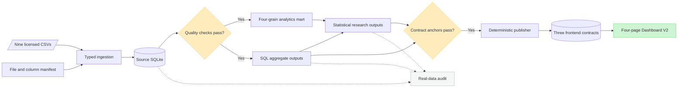

# Data lineage

Every published claim follows a documented path from licensed input to a validated aggregate. The frontend never reaches backward into source CSVs or SQLite databases.

## Grain map

| Artifact | Binding grain | Used for |
|---|---|---|
| Source orders | One source order | Status, timestamps, customer relationship |
| Source order items | One order item line | Merchandise value and category facts |
| `mart_delivered_orders` | One delivered order with an item | Order-level fulfillment and value controls |
| `mart_delivered_order_items` | One item line in a delivered order | Additive merchandise and freight reconciliation |
| `mart_customer_snapshot` | One observed customer before cutoff | Repeat-purchase origin and RFM snapshot |
| `mart_reviewed_orders` | One delivered order with a non-null review | Order-level satisfaction outcome |
| Frontend contracts | Month, category, cohort cell, segment, horizon, subgroup, or model summary | Aggregate-only visualization |

The exact contract assets and their source queries are listed in [Phase 3 dashboard data contracts](../PHASE3_DATA_CONTRACTS.md). The privacy and export boundary is enforced by [`tests/test_dashboard_data.py`](../../tests/test_dashboard_data.py) and [`tests/test_web_data_contract.py`](../../tests/test_web_data_contract.py).

## Deterministic publishing

[`scripts/publish_web_aggregates.py`](../../scripts/publish_web_aggregates.py) reads checked-in Phase 2 and Phase 2.5 evidence, validates known anchors, and writes the three JSON files under [`web/public/data/`](../../web/public/data/). Repeated publication is tested for byte-identical output. This keeps the browser independent of the licensed source files and prevents model fitting from drifting into the presentation layer.
