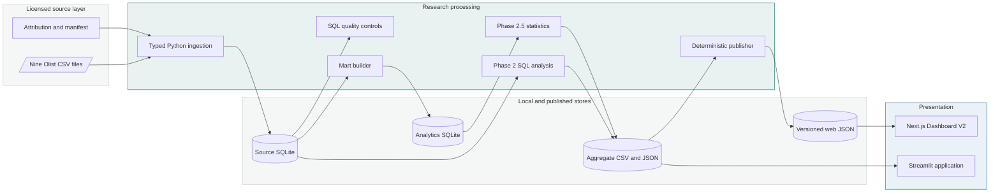

# System architecture

Olist Evidence Lab is a local-first analytical system. Licensed source files are ingested into SQLite, SQL establishes populations and analytical grain, Python implements documented estimators, and only checked-in aggregates cross the presentation boundary.

## Architectural boundaries

1. **Source fidelity:** [`src/olist_config.py`](../../src/olist_config.py) declares the exact nine-file and column manifest. Ingestion preserves each source grain and performs typed parsing, relational checks, and atomic replacement.
2. **Grain before facts:** source tables, delivered-order marts, item marts, customer snapshots, and reviewed-order marts remain physically separate. See the [SQL engineering guide](../engineering/SQL_ENGINEERING.md).
3. **Research before presentation:** SQL and standard-library Python produce the estimators and uncertainty. Neither dashboard refits the models.
4. **Aggregate presentation boundary:** the Next.js frontend consumes three strict JSON contracts; Streamlit consumes allowlisted aggregate CSV/JSON assets. Customer-level research extracts never become dashboard downloads.
5. **Two presentation generations:** Next.js Dashboard V2 is the portfolio direction. Streamlit remains a preserved legacy/current application, not a second research engine.

## Runtime components

| Component | Responsibility | Primary evidence |
|---|---|---|
| Python ingestion | Validate, parse, constrain, and atomically build source tables | [`src/ingest.py`](../../src/ingest.py) |
| SQL quality layer | Profile missingness, keys, joins, chronology, and fan-out | [`00_data_quality.sql`](../../sql/analysis/00_data_quality.sql) |
| Analytics mart | Bind four grains and block invalid reconciliation | [`sql/marts/`](../../sql/marts/) |
| Phase 2 analysis | Cohorts, RFM, trends, Pareto, and delivery aggregates | [`scripts/phase2_analysis.py`](../../scripts/phase2_analysis.py) |
| Phase 2.5 research | KM, adjusted models, diagnostics, heterogeneity, sensitivity | [`scripts/phase25_research.py`](../../scripts/phase25_research.py) |
| Aggregate publisher | Convert validated outputs into deterministic frontend JSON | [`scripts/publish_web_aggregates.py`](../../scripts/publish_web_aggregates.py) |
| Next.js V2 | Four responsive analytical and evidence views | [`web/app/`](../../web/app/) |
| Streamlit | Preserved four-page aggregate dashboard | [`app/`](../../app/) |

Continue with the [data lineage](DATA_LINEAGE.md) or the [engineering guide](../engineering/README.md).
