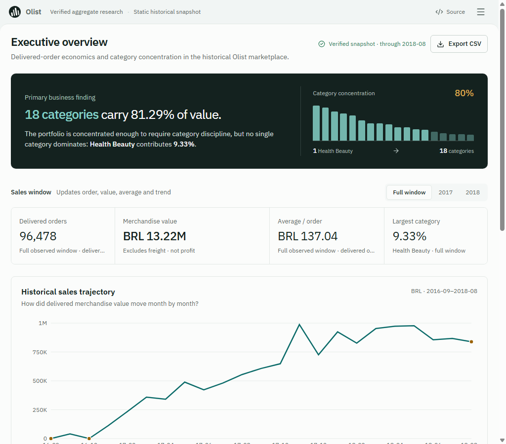
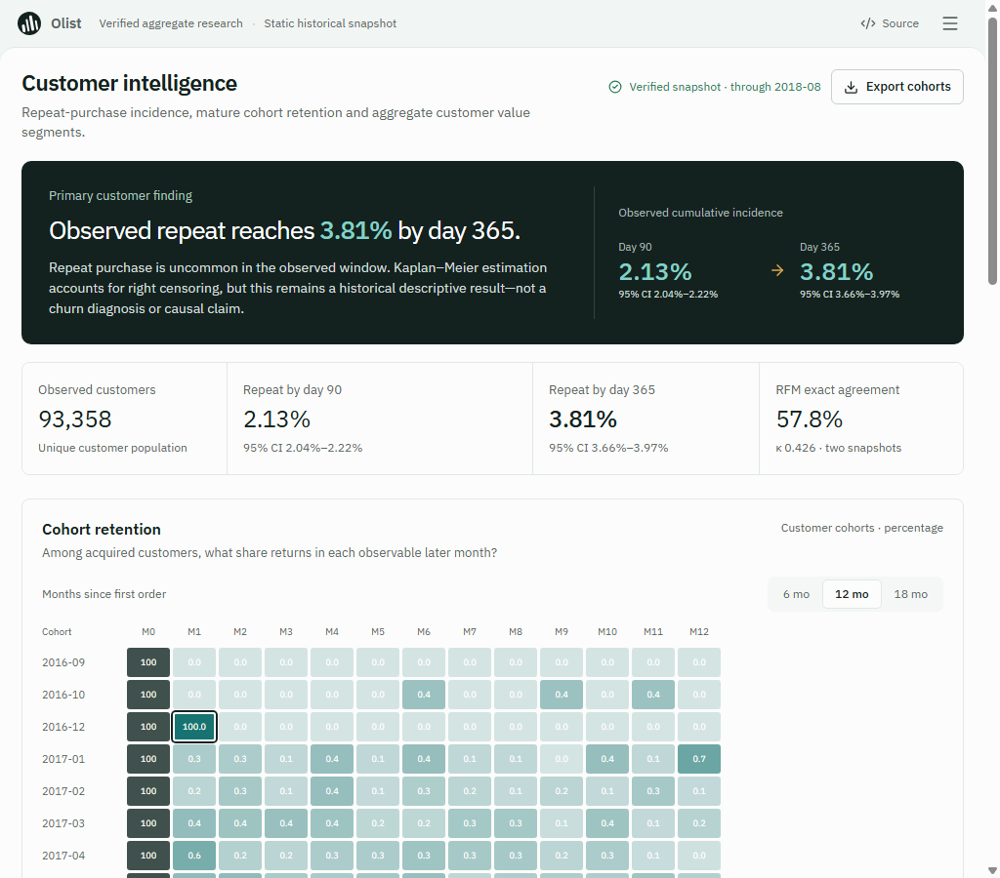
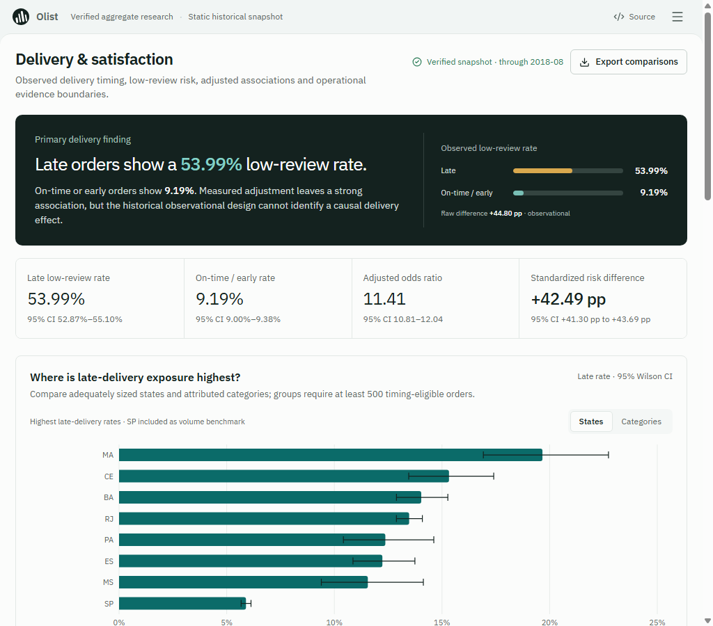
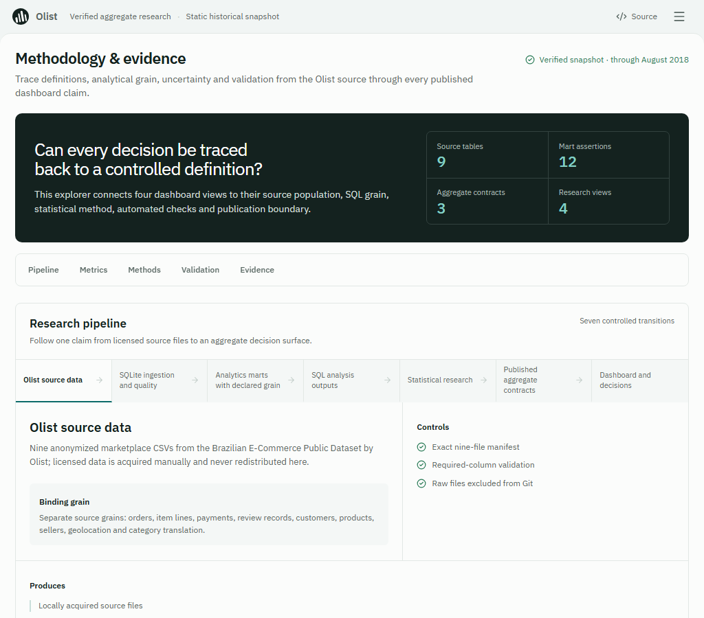

# Portfolio review guide

Olist Evidence Lab demonstrates end-to-end analytical engineering: relational ingestion, SQL quality controls, dimensional marts, statistical estimation, aggregate contracts, product-grade visualization, and explicit research limitations.

## Five-minute recruiter path

1. Read the project proposition and verified highlights in the [root README](../../README.md).
2. Inspect the four-page [Dashboard V2 source](../../web/app/) and screenshots below.
3. Read the two [research case studies](../research/README.md).
4. Review the [system architecture](../architecture/README.md) and [SQL engineering decisions](../engineering/SQL_ENGINEERING.md).
5. Check the [CI boundary](../engineering/CI.md), [tests](../../tests/), and [reproducibility guide](../engineering/README.md).

## Dashboard V2 gallery

| Executive overview | Customer intelligence |
|---|---|
|  |  |
| Delivery and satisfaction | Methodology and evidence |
|  |  |

These are genuine production-build browser captures. No public Next.js URL is listed because deployment has not been verified.

## What to inspect in code

- [`src/ingest.py`](../../src/ingest.py): typed parsing, constraints, staging, and atomic replacement.
- [`sql/analysis/`](../../sql/analysis/): business populations, grain-safe aggregates, cohorts, RFM, and delivery research inputs.
- [`sql/marts/`](../../sql/marts/): dimensional grain and reconciliation assertions.
- [`scripts/phase25_research.py`](../../scripts/phase25_research.py): standard-library KM, regression, standardization, diagnostics, and sensitivity analyses.
- [`scripts/publish_web_aggregates.py`](../../scripts/publish_web_aggregates.py): deterministic presentation boundary.
- [`web/components/`](../../web/components/): responsive analytical storytelling and uncertainty presentation.
- [`tests/`](../../tests/): synthetic known answers, real-data anchors, contracts, smoke tests, and repository hygiene.

For known gaps and their priority, see the [repository audit](REPOSITORY_AUDIT.md).
